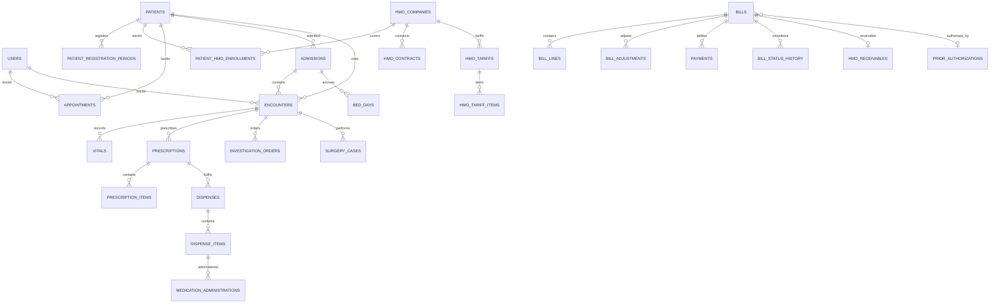
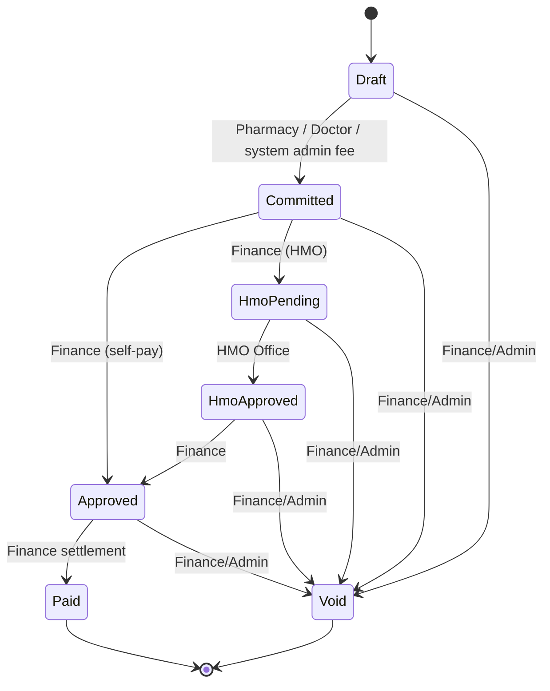

# 1. Domain model and PostgreSQL schema

The executable schema is the EF Core migration at `backend/Hms.Infrastructure/Persistence/Migrations/*_InitialCreate.cs`; the model snapshot is the source of truth for future migrations. The schema is `clinic`, using snake_case naming via `EFCore.NamingConventions`.

## 1.1 Design choices

| Topic | Decision |
|---|---|
| Keys | UUID v7 generated by the application. Human numbers come from PostgreSQL sequences. |
| Time | `timestamptz` for events; `date` for registration, contract and fitness dates. |
| Money | `numeric(14,2)`; `quantity` is `numeric(18,3)`. |
| Enum persistence | .NET enums converted to constrained strings. Critical billing invariants are also enforced by PostgreSQL check constraints. |
| Roles | One `StaffRole` per user. Admin receives the union of all permissions. |
| Outpatient | One `Encounter`. |
| Inpatient | One `Admission` containing one or more `Encounter` entries. |
| Billing | One non-void bill per context, with `BillLine` children. |
| HMO | Tariff lines, a PA record, line coverage decisions and a receivable. |
| Audit | Append-only `AuditLog`, plus `BillStatusHistory` for billing transitions. |

## 1.2 Enumerations

`StaffRole`: Receptionist, Nurse, Doctor, Pharmacy, Finance, HmoOffice, Admin, HrOffice.

`BillStatus`: Draft, Committed, HmoPending, HmoApproved, Approved, Paid, Void.

Other domain enums:

- `BillKind`: Registration, Appointment, Emergency, OutpatientEncounter, InpatientAdmission, FitnessCertificate.
- `PayerType`: SelfPay, Hmo.
- `BillLineCategory`: Registration, RegistrationRenewal, Appointment, Emergency, Consultation, Medication, Investigation, Surgery, BedDay, FitnessCertificate.
- `ChargeSourceType`: RegistrationPeriod, Appointment, Encounter, MedicationDispenseItem, MedicationAdministration, InvestigationOrder, SurgeryCase, BedDay, FitnessCertificate.
- `EncounterType`: Outpatient, Inpatient.
- `EncounterStatus`: Open, Completed, Cancelled.
- `AdmissionStatus`: Active, PendingDischarge, Discharged, Cancelled.
- `WardType`: General, Private.
- `AppointmentStatus`: Scheduled, CheckedIn, Completed, Cancelled, NoShow.
- `PrescriptionStatus`: Draft, SentToPharmacy, PartiallyDispensed, Dispensed, Cancelled.
- `InvestigationStatus`: Ordered, InProgress, Completed, Cancelled.
- `SurgeryStatus`: Scheduled, InProgress, Completed, Cancelled.
- `PriorAuthorizationStatus`: Requested, Issued, Rejected, Expired.
- `PaymentMethod`: Cash, Card, BankTransfer, HmoRemittance, Other.
- `HmoReceivableStatus`: Open, PartiallySettled, Settled, WrittenOff.
- `FitnessStatus`: Draft, Issued, Paid, Cancelled.
- `FeeCode`: RegistrationNew, RegistrationRenewal, Appointment, Emergency, InpatientConsultation, BedDayGeneral, BedDayPrivate, FitnessCertificate.

## 1.3 Aggregate map



## 1.4 Table catalogue

### Identity and configuration

| Table | Purpose | Important constraints/indexes |
|---|---|---|
| `users` | Identity user plus staff role, salary, bank and active flag | unique email/employee number; role + active index |
| `refresh_tokens` | Rotating refresh tokens | token hash unique; user/expiry index |
| `clinic_settings` | Configurable validity periods, currency, timezone, alert windows | key primary key |
| `fee_configurations` | Effective-dated flat fees | unique `(code, effective_from)`; amount >= 0; date check |
| `hmo_companies` | Partner metadata | unique code; `metadata_json` jsonb |
| `hmo_contracts` | Five-year contracts | one Active contract per HMO; date check |
| `hmo_tariffs` | Versioned tariff uploads | unique `(hmo_company_id, version)`; one Active tariff per HMO |
| `hmo_tariff_items` | Tariff lines | unique `(tariff_id, code)`; coverage 0–100 |

### Patients

| Table | Purpose | Important constraints/indexes |
|---|---|---|
| `patients` | Demographic and registration state | unique patient number; expiry index; name/phone indexes |
| `patient_registration_periods` | Registration and renewal history | one current period per patient; date and fee checks |
| `patient_hmo_enrollments` | Attached HMO membership IDs | one active membership per HMO/member ID; one active primary |

### Clinical

| Table | Purpose | Important constraints/indexes |
|---|---|---|
| `appointments` | Doctor bookings | unique active doctor/time slot; duration > 0 |
| `admissions` | Inpatient stay | one active/pending-discharge admission per patient; discharge date check |
| `encounters` | Outpatient visit or inpatient consultation entry | unique encounter number; type/admission check; one encounter per appointment |
| `vitals` | Nurse observations | pain score 0–10; encounter/time index |
| `bed_days` | Persisted nightly bed charge basis | unique `(admission_id, service_date)` |
| `medications` | Drug catalogue and stock on hand | unique code; non-negative stock/price |
| `stock_movements` | Append-only stock ledger | medication/time index |
| `prescriptions` / `prescription_items` | Doctor orders | encounter/status index; quantity checks |
| `dispenses` / `dispense_items` | Pharmacy dispensing | quantity and money checks |
| `medication_administrations` | Nurse administration evidence | encounter/time and nurse indexes |
| `investigation_catalog_items` | Investigation catalogue | unique code; non-negative price |
| `investigation_orders` | Investigation order/report | encounter/status index |
| `investigation_participants` | Practitioners involved | unique order/user/procedure role |
| `surgery_catalog_items` | Surgery catalogue | unique code; non-negative price |
| `surgery_cases` | Surgery schedule/report | encounter/status index |
| `surgery_participants` | Practitioners involved | unique case/user/procedure role |

### Billing and audit

| Table | Purpose | Important constraints/indexes |
|---|---|---|
| `bills` | Bill header and context | unique bill number; one non-void bill per context; approval checks |
| `bill_lines` | Traceable charges | unique source key; line arithmetic check |
| `bill_adjustments` | Audited negotiated discount | amount >= 0; status |
| `payments` | Patient/HMO settlement | idempotency key unique; amount > 0 |
| `hmo_receivables` | Receivable against PA | one per bill; PA linkage |
| `prior_authorizations` | PA code and context | unique `(hmo_company, pa_code)`; exactly one encounter/admission |
| `bill_status_history` | Billing transition trail | bill/time index |
| `account_book_entries` | Income/expense ledger | unique entry number; one income entry per payment |
| `fitness_certificates` | Medical fitness records | unique certificate number; `flexible_fields_json` jsonb |
| `audit_logs` | Append-only audit trail | time, entity, actor and bill indexes; jsonb before/after |

## 1.5 Critical billing constraints

```sql
-- Bill payable only with Finance approval.
status NOT IN ('Approved','Paid') OR finance_approved_at IS NOT NULL

-- HMO bill payable only with HMO approval.
status NOT IN ('HmoApproved','Approved','Paid')
  OR payer_type <> 'Hmo'
  OR hmo_approved_at IS NOT NULL

-- HMO bill must have a payer company.
payer_type <> 'Hmo' OR hmo_company_id IS NOT NULL

-- Line arithmetic.
net_amount = gross_amount - discount_amount
AND net_amount = hmo_amount + patient_amount
```

Application-level invariants add:

- HMO approval requires an issued, non-expired PA and Pharmacy tariff confirmation on medication lines.
- Finance approval of an HMO bill requires `HmoApproved` status and patient co-pay payment.
- A single HMO receivable is created at Finance approval and linked to the PA code.
- A bill cannot be paid before Finance approval.
- Paid status requires settlement of both patient and HMO portions.

## 1.6 Billing states



## 1.7 Assumptions

- **Registration** lasts 24 months; renewal begins at the later of today or current expiry.
- **HMO contracts** default to 60 months, configurable in `clinic_settings`.
- **Outpatient consultation** is covered by the appointment fee; no separate outpatient consultation line.
- **Emergency fee** is a separate administrative bill linked to the emergency encounter.
- **Bed-days** are billed per overnight, minimum one; discharge day is not charged by default.
- **Inpatient medication** is billed on Nurse administration; outpatient medication is billed on Pharmacy dispensing.
- **One HMO payer** is selected per encounter/admission even if the patient has multiple enrollments.
- **One bill per context**. Post-commit charges are not allowed in this version; a future supplemental-bill extension would be required.
- **No external HMO API**. The HMO Office manually captures PA and coverage.
