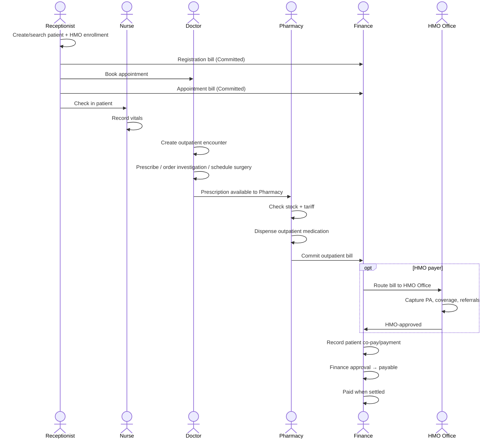

# 2. Workflow specification

## 2.1 Role ownership

| Stage | Owner | What the role may do |
|---|---|---|
| Registration / renewal | Receptionist | Search/create patient, attach HMO IDs, trigger registration fee bill |
| Appointment | Receptionist | Book doctor slot, trigger appointment fee bill |
| Triage | Nurse | Record vitals, administer prescribed medication; the scheduled list drops appointments once the visit bill is paid or invoiced to the HMO |
| Outpatient encounter | Doctor | Create encounter, order medications/investigations/surgery, file reports |
| Inpatient admission | Doctor | Create admission, add encounter entries, request and complete discharge |
| Pharmacy | Pharmacy | Pull prescription, check stock, dispense, confirm tariff, commit outpatient bill; work the Bills page (approve, negotiate, settle) |
| HMO authorisation | HMO Office | Capture PA, adjust coverage, HMO-approve the bill |
| Finance | Finance | View committed bills, negotiate, record payments, approve, record receivable, account book |
| Discharge clearance | Finance + Doctor | Finance makes bill payable; Doctor completes discharge only after clearance |
| HR | HR Office | Create users, salary/bank updates, disable accounts, export |
| Configuration | Admin | Fees, HMO companies/contracts, tariffs, settings, all other permissions |

## 2.2 Outpatient journey



### Outpatient states

| Object | States | Owner of transition |
|---|---|---|
| Appointment | Scheduled → CheckedIn → Completed / Cancelled / NoShow | Receptionist |
| Encounter | Open → Completed / Cancelled | Doctor |
| Prescription | SentToPharmacy → PartiallyDispensed → Dispensed / Cancelled | Pharmacy |
| Bill | Draft → Committed → HmoPending → HmoApproved → Approved → Paid | Pharmacy/Doctor/Finance/HMO Office |
| HMO receivable | Open → PartiallySettled → Settled / WrittenOff | Finance |

**Charge timing:** medication is billed when dispensed; investigation/surgery when the report is completed; appointment/emergency fees at their administrative event.

## 2.3 Inpatient journey

```mermaid
sequenceDiagram
    actor D as Doctor
    actor N as Nurse
    actor P as Pharmacy
    actor F as Finance
    actor H as HMO Office

    D->>D: Create admission + first inpatient encounter
    D->>D: Inpatient consultation charge added to draft admission bill
    N->>N: Record vitals
    P->>P: Dispense against encounter (no bill line yet)
    N->>N: Administer medication → charge line created
    D->>D: Add further inpatient encounter entries over stay
    D->>D: Order investigations/surgery; completed reports add charges
    D->>D: Request discharge + summary
    D->>D: Generate bed-days and commit final bill
    F->>F: Review/negotiate → route HMO if applicable
    H->>F: HMO approval
    F->>F: Record co-pay → Finance approval → receivable
    D->>D: Complete discharge only when bill is Approved/Paid
```

### Inpatient states

| Object | States | Owner |
|---|---|---|
| Admission | Active → PendingDischarge → Discharged / Cancelled | Doctor |
| Encounter entries | Open → Completed / Cancelled | Doctor |
| Admission bill | Draft → Committed → (HMO path) → Approved → Paid | Doctor at discharge, Finance, HMO Office |
| Bed-day | Created once per service date | Doctor/system at discharge request |

**Discharge gate:** `CompleteDischargeAsync` checks that the admission bill is Approved or Paid and that `BillStateMachine.EnsurePayable` passes. For HMO bills, this means PA + HMO approval + Finance approval are all present.

## 2.4 Billing transition table

| From | To | Actor | Preconditions |
|---|---|---|---|
| Draft | Committed | Pharmacy (outpatient), Doctor (inpatient), system (admin fee) | At least one line; totals recalculated |
| Committed | Approved | Finance | Self-pay; patient payment recorded |
| Committed | HmoPending | Finance | HMO payer |
| HmoPending | HmoApproved | HMO Office | PA issued/non-expired; tariff confirmed; coverage reviewed |
| HmoApproved | Approved | Finance | Patient co-pay paid; receivable fields available |
| Approved | Paid | Finance | Fully settled |
| Any non-paid/non-void | Void | Finance/Admin | Reason recorded; no settlement |
| Any unpaid (Committed/HmoPending/HmoApproved/Approved) | Debt | Finance/Pharmacy | Balance > 0; owner is the patient (self-pay) or the HMO company (HMO bill); settlement closes the debt |

**Debt ledger:** the Bills page has a **Debt** view. Moving a bill to debt hides it from the main bills list, records the owner and reason, and keeps it payable; recording the final payment sets `DebtSettledAt` and removes it from the active debt view. HMO bills are shown as owed by the HMO company.

## 2.5 HMO path

1. Pharmacy dispenses and, where applicable, confirms the HMO tariff item.
2. Finance routes the committed HMO bill to the HMO Office (`HmoPending`).
3. HMO Office captures PA code, expiry and approved amount.
4. HMO Office reviews each line: covered flag, HMO amount, patient amount and referral destination.
5. HMO Office approves only when:
   - PA is issued and not expired,
   - all medication lines have tariff confirmation,
   - line amounts reconcile,
   - bill payer/company match.
6. Finance records the patient co-pay, approves, and the system creates one `HmoReceivable` against the PA code.
7. The bill becomes `Paid` only when the patient and HMO portions are settled.

## 2.6 Exception paths

- **Registration expired:** renewal is required; a renewal bill is created. Existing clinical history remains visible.
- **HMO contract expired:** Admin must renew the contract or the HMO Office must reject coverage.
- **Missing tariff:** Pharmacy adds a warning; HMO Office must resolve the line before HMO approval.
- **Price negotiation:** Finance records an approved adjustment before final approval; audit log retains original and negotiated amounts.
- **PA expired:** HMO approval is blocked; a fresh PA must be captured.
- **Discharge before payment:** blocked for both self-pay and HMO. Approved means payable, not necessarily cash received; HMO receivable is allowed.
- **Payment retries:** `Payment.IdempotencyKey` prevents duplicate ledger entries.
