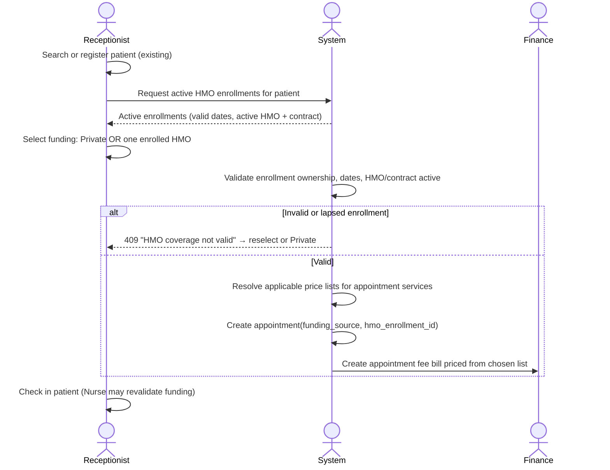

# 10. Funding, Stocks, structured encounter results — design proposal

> **Status: IMPLEMENTED.** All A1–A13 assumptions were accepted by the clinic and the design was built.
> The decision register below records the accepted choices; lines marked **MAPS TO** show where the
> current HMS schema already provided part of the capability.

---

## 0. Scope and decision register

The request changes four areas of the current HMS:

1. **Appointment funding** — every appointment must record who pays (Private or one of the patient's
   active HMO enrollments); the payer selects the price list used for that appointment's services.
2. **Stocks** — one catalogue of orderable items (medication, test, procedure) with a price per funding
   source; only medications carry a stock quantity.
3. **Encounter workflow** — drop ROS as a standalone field (keep optional ROS notes); order
   medications/tests/procedures uniformly from Stocks; every test/procedure order creates a result record;
   signing locks the clinical note **but not** results.
4. **Lab and procedure workflows** — new Lab role/section, queues for test and procedure requests, result
   entry with submit/save, and navigation back to the originating encounter.

### 0.1 Decisions that need confirmation

| ID | Area | Assumption made in this design | Why it matters / what to confirm |
|---|---|---|---|
| **A1** | Lab role | Add a new `StaffRole` value `Lab` with its own `/lab` route group and permissions. | The request says "lab role **or** section". Confirm whether lab users are a separate staff role or an additional section/department flag on existing `Pharmacy`/`Nurse` users. If it is a section, replace `Lab` in the matrix with a section-scoped permission set instead of a new role. |
| **A2** | Funding binding | Appointment funding is the **default** for all services on that appointment; it can be changed only before the first bill is committed, via an audited re-price (see EC-01). | If funding must be immutable from booking onwards, remove the re-price path and make EC-01 a hard block. |
| **A3** | Price semantics | An HMO price is the **gross item price** for that payer; the existing 0–100% `CoveragePercent` still splits the charge into `HmoAmount` and `PatientAmount`. | Confirm whether HMO price lists instead represent the covered portion only (in which case coverage % must not be applied again). |
| **A4** | Private price | The existing `Medication.UnitPrice`, `InvestigationCatalogItem.Price` and `SurgeryCatalogItem.Price` become `Private` rows in the new per-funding-source price table. | Confirm whether historical contract prices need to be retained as effective-dated versions (this design says yes). |
| **A5** | Result record | Each ordered test/procedure creates **one pending result record at order time**, not on result entry. | The request says "each added test or procedure generates a result record that is expected to be filled in later" — this is the literal reading. |
| **A6** | Result lifecycle | Results have their own status lifecycle, independent of `EncounterStatus`. Editing is allowed after signing; every save writes an audit/revision entry. | Confirm whether an amended result requires re-signing by the doctor or only an audit entry. |
| **A7** | Procedure editors | Doctors, Pharmacy, **Finance and Admin** may enter/save procedure findings (as requested). | This gives non-clinical roles write access to clinical findings. Confirm clinical-governance/legal acceptability; the safer alternative is Finance/Admin view-only. |
| **A8** | Billing after re-price | Changing funding after a bill is committed requires a credit/adjustment plus a supplemental bill or a cancel-and-re-order; the current scaffold has **no supplemental-bill flow**. | Confirm which financial correction mechanism the clinic uses. No new table is proposed here — this is an explicit open dependency. |
| **A9** | HMO lapse | On lapse, already-ordered/consumed services remain HMO-funded; **new** orders require re-selection of funding. | Confirm whether lapsed-but-unconsumed orders should auto-convert to Private (needs patient consent) or be cancelled. |
| **A10** | Walk-ins / emergencies | If no appointment exists, funding is selected when the encounter is created; all subsequent rules are identical. | Confirm for emergency and inpatient encounters. |
| **A11** | Substitution | Catalog prices are snapshotted onto each order line at order time; later tariff changes do not alter existing orders. | Confirm the rule for retroactive tariff changes (normally prohibited). |
| **A12** | Notifications | No email/SMS adapter exists. Result availability and funding lapses are recorded in-app/audit only. | Confirm whether notifications are part of this delivery. |
| **A13** | Appointment fee under HMO | `BillingService.CreateAdministrativeBillAsync` currently **always** creates a `SelfPay` bill using `FeeConfiguration`. This design assumes HMO-funded appointments also price their appointment/consultation fee from an HMO price row (tariff code), with Private as fallback and a warning if unmapped. | Confirm whether HMOs pay the appointment fee at all. If not, keep the appointment fee Private even when clinical services are HMO-funded (mixed-payer bill needs explicit design). |

### 0.2 Current-state gaps this change must close

Verified against the code (not assumptions):

1. **No explicit private price** — private price is implicit in `medications.unit_price`,
   `investigation_catalog_items.price`, `surgery_catalog_items.price`, and administrative fees in
   `fee_configurations`. There is no effective-dated per-payer price table.
2. **No funding on appointments** — `CreateAppointmentRequest` has no payer fields; `AppointmentService`
   always creates a SelfPay fee bill. The doctor's encounter creation accepts a free-text
   `hmoEnrollmentId` that is passed as `null` for queue-created encounters; it must instead be
   inherited from a validated appointment funding choice.
3. **The clerking form drops all orders** — prescriptions, lab orders and procedures are collected in
   the UI but `buildSaveRequest()` in `clerking-form.component.ts` omits them, and
   `SaveEncounterRequest` has no fields for them. The backend order endpoints exist but have no
   frontend API methods or screens. This delivery must add the order-persistence path.
4. **Result entry is doctor-only and binary** — `POST /clinical/investigations/{id}/complete` and
   `/surgeries/{id}/complete` are gated by `investigations.write`/`surgeries.write` (Doctor + Admin).
   There is no pending-result record, no re-editable result state and no lab role/queue.
5. **Signing locks everything today** — `SaveEncounterAsync` rejects all edits once status is
   `Completed`; EC-02 requires that only clinical text be locked.
6. **No catalogue CRUD** — `/api/reference/{medications,investigations,procedures}` is read-only;
   Stocks needs item and price maintenance endpoints (`stock.manage`).

---

## 1. Role and permissions matrix

### 1.1 Roles

Existing roles (`Hms.Domain.Enums.StaffRole`):
`Receptionist`, `Nurse`, `Doctor`, `Pharmacy`, `Finance`, `HmoOffice`, `Admin`, `HrOffice`.
Proposed new role (A1): **`Lab`**. `Admin` continues to receive the union of all permissions.

### 1.2 Permission catalogue changes

The current system already has 53 constants in `Hms.Application/Security/Permissions.cs`, all listed in
`PermissionCatalog.All`. **Reuse where possible** — do not create a parallel permission vocabulary:

| Permission | Change | Meaning |
|---|---|---|
| `investigations.write` | existing, **grant to Lab + Pharmacy** | Create test requests (Doctor) **and** enter/update/submit test results (Lab, Pharmacy) |
| `surgeries.write` | existing, **grant to Pharmacy, Finance, Admin** *(A7)* | Create procedure requests (Doctor) **and** enter/update/save procedure findings |
| `encounters.read` | existing, **grant to Lab** | Needed to open the originating encounter from a request |
| `patients.read` | existing | Prerequisite for the reference/Stocks lookups (`ReferenceController` is already policy-gated with it) |
| `pharmacy.stock.manage` | existing, keep; add `stock.manage` for the unified catalogue | Item/price maintenance moves from Pharmacy-only to Admin-owned Stocks |
| `funding.verify` | **new** | Select and validate the funding source when booking / checking in / creating an encounter |
| `stock.read` | **new** | Browse Stocks and the caller-visible prices |
| `stock.manage` | **new** | Create/edit catalogue items and per-funding-source price rows (Admin) |
| `lab.requests.read` | **new** | View the test-request queue (Lab, Pharmacy; Doctor sees own) |
| `procedures.requests.read` | **new** | View the procedure-request queue (Doctor, Pharmacy, Finance, Admin) |
| `encounters.sign` | **new** | Sign/complete a clinical encounter; currently signing is folded into `encounters.write` |

> All new constants must be added to `Permissions.cs` **and** `PermissionCatalog.All`; policies are generated
> from `All` in `Program.cs` and the permission claim list in the JWT comes from `PermissionCatalog.ForRole`.
> The frontend `StaffRole` union in `core/models.ts` and the HR role picker must also include `Lab`.

### 1.3 Matrix

Legend: **✓** full access · **◐** read-only / restricted · **—** no access · **U** union of all (Admin).
"Own" = only requests attached to the user's own encounter/patient context. Admin = `PermissionCatalog.All`.

| Capability (permission) | Reception | Nurse | Doctor | Lab *(new)* | Pharmacy | Finance | HMO Office | HR | Admin |
|---|---|---|---|---|---|---|---|---|---|
| Verify/select funding (`funding.verify`) | ✓ | ◐ check-in | ◐ encounter | — | — | ◐ review | ◐ coverage | — | U |
| Browse Stocks + prices (`stock.read`, `patients.read`) | ◐ names | ◐ | ✓ | ✓ tests | ✓ | ◐ prices | ◐ tariffs | — | U |
| Manage Stocks / prices (`stock.manage`, `hmo.tariff.manage`) | — | — | — | — | — | — | ◐ HMO tariff lines | — | U |
| Create appointment (`appointments.create`) | ✓ | — | — | — | — | — | — | — | U |
| Check in (`appointments.create`) | ✓ | ✓ | — | — | — | — | — | — | U |
| Create/save encounter (`encounters.write`) | — | — | ✓ own | — | — | — | — | — | U |
| Sign encounter (`encounters.sign`) | — | — | ✓ own | — | — | — | — | — | U |
| Order from Stocks (`prescriptions.write`, `investigations.write`, `surgeries.write`) | — | — | ✓ | — | — | — | — | — | U |
| Save clinical note (subjective/objective/assessment) | — | — | ✓ own | — | — | — | — | — | U |
| Record vitals (`vitals.write`) | — | ✓ | ◐ read | — | — | — | — | — | U |
| View **test** request queue (`lab.requests.read`) | — | — | ✓ own | ✓ | ✓ | — | — | — | U |
| Enter/update/submit **test** results (`investigations.write`) | — | — | — | ✓ | ✓ | — | — | — | U |
| View **procedure** request queue (`procedures.requests.read`) | — | — | ✓ own | — | ✓ | ✓ | — | — | U |
| Enter/save **procedure** findings (`surgeries.write`) *(A7)* | — | — | ✓ own | — | ✓ | ✓ | — | — | U |
| Navigate request → encounter (`encounters.read`) | — | — | ✓ | ✓ | ✓ | ✓ | ◐ | — | U |
| Edit results **after sign-off** (own result permission + A6) | — | — | ◐ own | ✓ tests | ✓ both | ✓ procedures | — | — | U |
| Dispense / administer (`pharmacy.dispense`, `medications.administer`) | — | ✓ administer | — | — | ✓ dispense | — | — | — | U |
| Bill / approve / payment (`billing.*`, `hmo.approve`) | — | — | — | — | ◐ commit | ✓ | ◐ HMO approve | — | U |
| HR / fees / contracts / settings (`hr.*`, `admin.*`) | — | — | — | — | — | — | ◐ tariffs | ✓ | U |

**Role separation rules carried over from the current system:** Pharmacy dispenses and commits but never
approves a bill; Finance approves/pays but never dispenses; HMO Office approves coverage but never pays;
Doctor owns the clinical note but does not own HMO/medication billing approvals. The new Lab role has
**no** billing, dispensing or clinical-note permissions.

**Frontend impact:** add a `/lab` route group in `app.routes.ts` guarded by
`roles: ['Lab'], permissions: ['lab.requests.read']`, plus test/procedure queue screens. Add funding
selection to the reception appointment screen. Remove the ROS checkbox group from
`clerking-form.component.html` (keep the optional ROS notes textarea) and the standalone procedure chip
list; replace the Plan section with a single Stocks-based item picker.

---

## 2. Data model

### 2.1 Entity-relationship overview

```mermaid
erDiagram
    PATIENTS ||--o{ PATIENT_HMO_ENROLLMENTS : "enrolled in"
    HMO_COMPANIES ||--o{ PATIENT_HMO_ENROLLMENTS : "covers"
    HMO_COMPANIES ||--o{ HMO_TARIFFS : "price list versions"
    HMO_TARIFFS ||--o{ HMO_TARIFF_ITEMS : "per-item price + coverage"

    PATIENTS ||--o{ APPOINTMENTS : books
    PATIENTS ||--o{ ENCOUNTERS : visits
    APPOINTMENTS ||--o| ENCOUNTERS : "gives rise to"
    APPOINTMENTS }o--o| PATIENT_HMO_ENROLLMENTS : "funding (null = Private)"
    ENCOUNTERS }o--o| PATIENT_HMO_ENROLLMENTS : "funding (null = Private)"

    STOCK_ITEMS ||--o{ ITEM_PRICES : "price per funding source"
    HMO_COMPANIES ||--o{ ITEM_PRICES : "HMO price rows"
    STOCK_ITEMS ||--o| STOCK_BALANCES : "medication only"
    STOCK_BALANCES ||--o{ STOCK_MOVEMENTS : ledger

    ENCOUNTERS ||--o{ SERVICE_REQUESTS : "orders (test/procedure)"
    STOCK_ITEMS ||--o{ SERVICE_REQUESTS : "catalogue item"
    SERVICE_REQUESTS ||--|| SERVICE_RESULTS : "created at order time (A5)"
    SERVICE_RESULTS ||--o{ SERVICE_RESULT_REVISIONS : audit trail
    ENCOUNTERS ||--o{ PRESCRIPTIONS : "medication orders"

    SERVICE_REQUESTS ||--o| BILL_LINES : "charge (snapshot price)"
    PRESCRIPTIONS ||--o| BILL_LINES : "charge on dispense"
    BILLS ||--o{ BILL_LINES : contains
    BILLS }o--o| PATIENT_HMO_ENROLLMENTS : payer
```



### 2.2 New and changed tables

| Table | Purpose | Key columns / constraints |
|---|---|---|
| `appointments` **(changed)** | Booking | add `funding_source` (`Private`/`Hmo`, not null, default Private); add `hmo_enrollment_id` (nullable FK → `patient_hmo_enrollments`); check `(funding_source='Private' AND hmo_enrollment_id IS NULL) OR (funding_source='Hmo' AND hmo_enrollment_id IS NOT NULL)`. **MAPS TO** existing `appointments`. |
| `encounters` **(changed)** | Visit | add same `funding_source` + `hmo_enrollment_id` pair, inherited from appointment at creation; same check constraint. **MAPS TO** existing structured encounter (`presenting_complaint`, `history_of_presenting_complaint`, …, `disposition`). |
| `stock_items` **(new)** | **Single source of orderable items**; replaces three catalogues | `id` (UUIDv7), `code` unique, `name`, `item_type` (`Medication`/`Test`/`Procedure`), `generic_name?`, `form?`, `strength?`, `unit` default `unit`, `tariff_code?`, `is_active`, timestamps. **MAPS TO** `medications`, `investigation_catalog_items`, `surgery_catalog_items` (migrate their rows; keep old tables as views during transition if needed). |
| `item_prices` **(new)** | **Price per funding source**, effective-dated | `stock_item_id`, `funding_source`, `hmo_company_id?`, `unit_price` numeric(14,2), `coverage_percent` (0–100, default 100 for HMO), `requires_prior_authorization` bool, `effective_from`, `effective_to?`, `is_active`. Unique `(stock_item_id, funding_source, hmo_company_id, effective_from)`. Check Private ⇒ `hmo_company_id IS NULL`. **MAPS TO** `medications.unit_price`, `investigation_catalog_items.price`, `surgery_catalog_items.price` (Private rows) and `hmo_tariff_items` (HMO rows). |
| `stock_balances` **(new, medication only)** | Quantity on hand | `stock_item_id` unique FK, `quantity_on_hand` numeric(18,3) ≥ 0, `reorder_level` ≥ 0, `updated_at`. **MAPS TO** `medications.stock_on_hand` / `reorder_level`. Tests/procedures get **no row**. |
| `stock_movements` **(kept)** | Append-only quantity ledger | FK changes to `stock_item_id`; `movement_type`, `quantity_delta`, `reference_type/id`, actor/timestamp. Only medication items may have rows. |
| `service_requests` **(new)** | A doctor's test/procedure order linked to the encounter | `id`, `request_number` (sequence), `encounter_id` FK (indexed — this is the required navigation back), `patient_id`, `stock_item_id`, `kind` (`Test`/`Procedure`), `doctor_id`, `status` (`Pending`/`InProgress`/`Completed`/`Cancelled`), `ordered_at`, `funding_source` **snapshot**, `hmo_company_id?` **snapshot**, `hmo_tariff_id?`/`item_price_id?` **snapshot**, `unit_price_snapshot`, `priority`, `clinical_note?`, timestamps. **MAPS TO** `investigation_orders` (tests) and `surgery_cases` (procedures). |
| `service_results` **(new, created with each request)** | Result/findings record; editable after encounter sign-off | `request_id` unique FK, `status` (`Pending`/`Entered`/`Submitted`/`Amended`), `result_text?`, `findings?`, `structured_json?` jsonb, `abnormal_flag?`, `performed_at?`, `entered_by?`, `entered_at?`, `submitted_by?`, `submitted_at?`, `version` int. **MAPS TO** `investigation_orders.report_text/report_file_ref`, `surgery_cases.report_text`. |
| `service_result_revisions` **(new)** | Append-only audit of every result edit | `result_id`, `version`, `before_json`/`after_json`, `actor_id`, `actor_role`, `occurred_at`, `reason?`. Complements the existing `audit_logs`. |
| `bill_lines` **(kept, extended)** | Charge snapshots | add `service_request_id?` for traceability; `unit_price`, `source_key`, `hmo_amount`, `patient_amount` already exist. Price comes from `item_prices` at **order** time, not at result time. |
| `fee_configurations` **(kept)** | Effective-dated flat administrative fees (`FeeCode`: Appointment, Registration, Emergency, BedDay, …) | Still used for non-Stocks administrative charges; extend `BillingService.CreateAdministrativeBillAsync` so the appointment fee can be resolved from an HMO price row when funding is HMO (A13). |
| `hmo_tariffs` / `hmo_tariff_items` **(kept as source)** | Existing HMO price lists | Remain the authoritative import/versioning surface; `AdminService.Tariffs.cs` CSV import/export and `TariffPricingService.ResolveAsync` are extended to write/read `item_prices` so every Stocks item has a row per payer. `PharmacyService.GetPriceOptionsAsync` already shows Private vs HMO side by side — reuse that presentation for Stocks. |

### 2.3 Constraints and invariants (enforce in DB + application)

```sql
-- Funding source is internally consistent everywhere it appears.
CHECK ((funding_source = 'Private' AND hmo_enrollment_id IS NULL)
    OR (funding_source = 'Hmo'     AND hmo_enrollment_id IS NOT NULL))

-- Only medications may hold stock quantities (request: tests/procedures have none).
CHECK ((item_type = 'Medication' AND quantity_on_hand IS NOT NULL)
    OR (item_type <> 'Medication' AND quantity_on_hand IS NULL AND reorder_level IS NULL))

-- A result cannot be submitted empty.
CHECK (status <> 'Submitted' OR coalesce(length(trim(result_text)), length(trim(findings))) > 0)
```

Application invariants:

1. **Funding validation** — `Hmo` requires an enrollment that belongs to the patient, `IsActive = true`,
   `ValidFrom <= service date <= coalesce(ValidTo, 'infinity')`, parent `hmo_companies.IsActive = true`,
   and an active/non-expired `hmo_contracts` row. Otherwise reject with a clear 409.
2. **Price resolution** — pick the `item_prices` row with the matching funding source and HMO company
   whose effective window covers the service date and `IsActive = true`; if none, use Private price with
   a warning and require Finance/HMO Office resolution before bill approval (mirrors current
   `BillingService.AddChargeAsync` behaviour).
3. **Price snapshot** — copy `item_price_id`, `unit_price`, `hmo_company_id`, `funding_source` onto
   the request/order line and `bill_line`; never re-resolve after commit (A11).
4. **Sign-off separation** — doctor signing sets `encounters.status = Completed` and locks the
   structured clinical text fields only. `service_results` writes are gated by their own permissions
   and status, never by `encounters.status` (A6).
5. **Medication stock** — prescribing checks `quantity_on_hand`; dispensing decrements it and writes a
   `stock_movement` in the same transaction; tests/procedures never touch stock.
6. **No hard deletes** of clinical rows (retain current convention); cancellations set status.

### 2.4 Enums added

| Enum | Values |
|---|---|
| `FundingSource` | `Private`, `Hmo` |
| `StockItemType` | `Medication`, `Test`, `Procedure` |
| `ServiceRequestStatus` | `Pending`, `InProgress`, `Completed`, `Cancelled` |
| `ServiceResultStatus` | `Pending`, `Entered`, `Submitted`, `Amended` |

Enums follow the existing convention: stored as constrained strings in `varchar(n)` via
`.HaveConversion<string>().HaveMaxLength(n)`.

### 2.5 Migration outline

1. Add enum conversions and the six new tables (`stock_items`, `item_prices`, `stock_balances`,
   `service_requests`, `service_results`, `service_result_revisions`) to `HmsDbContext` / model snapshot;
   new EF migration `FundingStockAndServiceResults` (PostgreSQL, schema `clinic`, snake_case, UUIDv7 keys).
2. Backfill `stock_items` from `medications`, `investigation_catalog_items`, `surgery_catalog_items`;
   backfill Private `item_prices` from their price columns; backfill HMO `item_prices` from
   `hmo_tariff_items` via `tariff_code`.
3. Backfill `stock_balances` from `medications.stock_on_hand`/`reorder_level`.
4. Backfill `service_requests` + `service_results` from existing `investigation_orders` and
   `surgery_cases` (map statuses, copy report text into result rows).
5. Backfill new `funding_source`/`hmo_enrollment_id` from existing
   `appointments`/`encounters`/`bills` `payer_type`/`hmo_enrollment_id`.
6. Keep old catalog tables and order tables for one release as compatibility views if a staged
   rollout is required; otherwise drop them in a follow-up migration after all code paths are cut over.

---

## 3. Step-by-step user flows

### 3.1 Appointment creation with funding verification



1. Reception searches/registers the patient and requests active enrollments.
2. Reception selects **Private** or one HMO from the patient's **active, in-date** enrollments; manual entry
   of an arbitrary HMO id is rejected.
3. Backend re-validates the selection (never trusts the UI) and resolves the price list for the
   appointment fee and any services attached at booking.
4. Appointment + bill are created in one transaction; funding and price snapshot are stored. The
   appointment fee is priced from the chosen payer's list (HMO tariff row when mapped, Private
   `FeeConfiguration` otherwise, with an unmapped-code warning) — **A13**.
5. Nurse check-in re-validates funding and flags a lapse discovered between booking and visit (EC-03).
6. Emergency/walk-in without an appointment applies the same rule at encounter creation (A10).

### 3.2 Encounter documentation (doctor)

```mermaid
sequenceDiagram
    actor D as Doctor
    actor S as System
    D->>S: Open checked-in appointment / create encounter
    S-->>D: Encounter pre-filled with appointment funding + price list
    D->>D: Subjective: presenting complaint, HPI, PMH, family history, optional ROS notes
    Note over D: ROS checkbox group removed; ROS notes textarea remains optional
    D->>D: Objective: examination list (<=20), findings
    D->>D: Assessment: diagnosis, disposition
    D->>S: Plan: search Stocks (medication / test / procedure)
    S-->>D: Items with price for the encounter's funding source
    D->>S: Add selected items
    S->>S: Medications → prescription items (stock check)
    S->>S: Tests/procedures → service_request + pending service_result
    S-->>D: Request list with "Result pending" badges
    D->>D: Optional draft save (structured payload)
    D->>S: Sign & complete
    S->>S: Lock clinical text; leave service_results editable
```

1. Doctor opens the encounter; funding/price list inherited from the appointment (A2) and displayed.
2. **Subjective:** presenting complaint, HPI, past medical/surgical history, family history, allergies,
   and **optional ROS notes** only — the ROS checkbox grid is removed.
3. **Objective:** examination entries (max 20) and point-of-care observations.
4. **Assessment:** diagnosis and disposition.
5. **Plan:** one Stocks picker replaces the separate prescription/test/procedure entry points and the
   standalone in-clinic procedure field:
   - selecting a **medication** creates a prescription item (quantity/dose/route/frequency), checks stock;
   - selecting a **test** or **procedure** creates a `service_request` linked to the encounter **and**
     a `service_result` row with status `Pending` (A5).
6. Prices are taken from the funding-specific `item_prices` and snapshotted onto each order/bill line.
7. Doctor may save drafts; signing requires presenting complaint + diagnosis + disposition (existing
   validation) and sets the encounter to `Completed`. **Results remain editable** (A6).

### 3.3 Result entry

**Lab (tests):**
1. Lab staff (and Pharmacy) open `/lab` → *Test requests* queue: pending/submitted requests with patient,
   encounter number, test name, ordered time, priority, status.
2. Open a request → enter result text/findings, optional structured values, abnormal flag; use
   "link to encounter" to navigate to the originating encounter.
3. **Save** keeps status `Entered` (re-editable); **Submit** sets `Submitted`, records actor/time and writes
   a revision. Submit also creates the billable line for the request, mirroring the current
   `CompleteInvestigationAsync` behaviour — but using the **snapshotted order price**, never a price
   re-resolved at result time. A submitted result can still be amended, which sets `Amended` and
   preserves history (A6).

**Procedures:**
1. Doctors (own), Pharmacy, Finance and Admin open the procedure requests queue (A7).
2. Add findings/result, save or submit; same status lifecycle and revision trail as test results.
3. Every queue row links back to the originating encounter via `encounter_id`.

### 3.4 Encounter sign-off

1. Doctor clicks **Sign & Complete** (`encounters.sign`); backend validator re-checks required fields and funding/price
   snapshot completeness.
2. Encounter status → `Completed`; `ClosedAt` set; clinical text fields become read-only.
3. Pending results do **not** block sign-off (they may be entered later). Completed results do not
   auto-close the encounter.
4. Bill lines already created from the order snapshots remain valid; result entry does not change prices.
5. A second sign attempt returns 409 (current behaviour, covered by integration tests).
6. Result changes after sign-off are audited via `service_result_revisions` + `audit_logs` and are visible
   in the patient record and request queues; the encounter stays `Completed`.

---

## 4. Edge cases

| ID | Case | Trigger | Expected behaviour | Owner | Open decision |
|---|---|---|---|---|---|
| **EC-01** | **Funding changed after prices applied** | User attempts to switch Private ↔ HMO, or HMO A → HMO B, after order/bill lines exist | Before any bill commit: allowed only through a re-price transaction — re-resolve prices for **all** unconsumed lines, write audit before/after, update snapshots. After commit: block in-place change; require credit/adjustment + supplemental bill or cancel-and-re-order. Never silently reprice historical lines. | Reception + Finance | **A2, A8** — confirmation needed on correction mechanism. |
| **EC-02** | **Editing results after sign-off** | Result entered/updated when encounter status = `Completed` | Allowed for roles with result-write permission. Append revision + audit; status → `Amended`; encounter remains `Completed`; no change to bill lines or clinical note. | Lab/Pharmacy (tests); Doctor/Pharmacy/Finance/Admin (procedures) | **A6, A7** — whether doctor re-sign is required. |
| **EC-03** | **HMO coverage lapses mid-treatment** | Enrollment `ValidTo` passes, HMO/contract deactivated, or PA expires after booking but before/during treatment | Revalidate at check-in, encounter creation, each order and bill approval. Already-ordered/consumed services stay on the original HMO snapshot; new orders blocked until funding is reselected or coverage renewed. HMO Office + Finance see a flagged bill/PA and decide recovery. | HMO Office + Finance; Reception reselects | **A9** — auto-convert to Private vs hold/cancel. |
| **EC-04** | No active enrollment at booking | Patient has only expired/inactive HMOs | HMO option hidden/disabled; only Private accepted; flag expired enrollment for renewal. | Reception | — |
| **EC-05** | HMO not enrolled by patient | User tries to select an arbitrary HMO id | Backend 409: enrollment must belong to the patient and be active; never trust client-side filtering. | System | — |
| **EC-06** | Missing price for selected funding | No active `item_prices` row for item + payer | Order allowed with Private-price fallback + warning; HMO Office/Finance must resolve before approval (matches current missing-tariff behaviour). | Finance/HMO Office | **A3, A4** |
| **EC-07** | Medication out of stock | `quantity_on_hand` below prescribed/dispense quantity | Block prescription/dispense (or allow with backorder flag — choose one); write stock movement only on actual dispense. Tests/procedures unaffected. | Pharmacy | Confirm backorder policy. |
| **EC-08** | Duplicate order | Doctor re-adds the same test/procedure | Prevent exact duplicate pending requests for same encounter + item; offer "add another" only with a clinical reason. | Doctor | Confirm whether repeat tests are routine. |
| **EC-09** | Result submitted then amended | User edits a `Submitted` result | Create new version; status `Amended`; keep all prior versions; show "amended" badge in queues and patient record. | Result editor | **A6** |
| **EC-10** | Pending results at sign-off / billing | Doctor signs while results are pending | Sign-off succeeds; billing of test/procedure lines follows the existing rule (charge on report completion) — flag pending items on the bill for Finance. | Doctor + Finance | Confirm whether pending results may be billed. |
| **EC-11** | Stock quantity on a test/procedure | Migration or API tries to set quantity for non-medication | DB check constraint rejects; API validator returns 400. | System | — |
| **EC-12** | Price list version changes after ordering | New HMO tariff imported between order and billing | Order keeps its snapshot; no retroactive repricing; report variance to Finance. | Finance | **A11** |
| **EC-13** | Multiple active HMO enrollments | Patient has several valid HMOs | All selectable; selection defaults to `IsPrimary` but is overridable per appointment; stored explicitly. | Reception | — |
| **EC-14** | Appointment cancelled after encounter created | Appointment status → Cancelled with linked encounter | Keep encounter and results (clinical record); flag inconsistency for Admin; do not delete clinical rows. | Admin | — |
| **EC-15** | Non-clinical role writes procedure findings | Finance/Admin saves findings under A7 | Permitted as requested, with mandatory actor/revision audit; consider restricting to view-only. | Finance/Admin | **A7** — governance confirmation. |
| **EC-16** | Registration expired at booking | Patient status expired | Renewal required first; existing clinical history stays visible (existing rule). | Reception | — |

---

## 5. Implementation notes (as delivered)

- **A1–A13 accepted**: new `Lab` staff role, Finance/Admin procedure-finding writes, result records created
  at order time, results editable after signing, no supplemental-bill flow, price snapshots, etc.
- The three legacy catalogue tables (`medications`, `investigation_catalog_items`, `surgery_catalog_items`)
  were replaced by `stock_items`; `item_prices` carries Private and per-HMO prices; `stock_balances` only
  has rows for medications (DB check constraint + service validation).
- `service_requests` / `service_results` / `service_result_revisions` are the order and result records.
  Legacy `investigation_orders` / `surgery_cases` remain only for the pre-existing billing/dispense paths.
- Appointment funding is validated at booking and re-checked at check-in; encounters inherit it. The
  appointment fee uses HMO tariff code **`APPOINTMENT`** when funded by an HMO, falling back to the
  private `FeeConfiguration` with a warning (A13).
- Signing is a separate permission (`encounters.sign`); results are gated by
  `investigations.write` / `surgeries.write` and ignore encounter status.
- Local dev database was dropped and recreated from the migration set as authorised.

## 6. Delivery checklist for implementation

- [x] Add permissions/constants and role mapping; JWT policies and Angular route guards (incl. `/lab`).
- [x] EF migration + backfill per §2.5; constraints per §2.3; integration tests for each.
- [x] Appointment command/validator + reception UI funding step; encounter creation inherits **validated**
      funding (replace the current free-text `hmoEnrollmentId`); admin bill follows A13.
- [x] Stocks catalogue API + per-payer price CRUD (`stock.manage`) and read endpoints (`stock.read`);
      extend `TariffPricingService`/CSV import and reuse `GetPriceOptionsAsync` presentation.
- [x] Clerking form: remove ROS grid (keep notes), replace procedure chip list with unified Stocks picker;
      **persist the collected orders** (currently dropped by `buildSaveRequest()`).
- [x] Service request + result services; lab/procedure queues, result entry and submit screens;
      submit creates the bill line from the snapshotted order price.
- [x] Sign-off rule change: lock clinical text only; result writes independent of encounter status; revision audit.
- [x] Tests: funding validation, price snapshot, per-payer pricing, medication-only stock, result lifecycle,
      post-sign edits, all three named edge cases.
